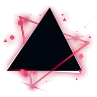

<h1> Evlyn</h1>

Hi~ I'm **Evlyn** (Ev1yn), a high-school developer from Thailand and Co-Founder of **LMD TEAM**. I build websites, Discord bots and anything that challenges me, from the frontend to the backend and on-chain. Still learning every day while studying, but welcome to my profile! <3

## My Top Skills
189 skills, the same list as on <a href="https://ev1yn.online/about">ev1yn.online/about</a>. Click an icon to learn it.

#### Programming Languages · 41

               
               
          

#### Frameworks · 34

               
               
   

#### Libraries · 25

               
         

#### AI & Machine Learning · 11

          

#### Databases · 11

          

#### CDN & Cloud Services · 13

            

#### DevOps & Infrastructure · 11

          

#### Testing · 7

      

#### Game Development · 7

      

#### Software & Design · 18

               
  

#### Operating Systems · 11

          

### Main Skills

      

## About Me
-  **Name**: Evlyn (Ev1yn)
-  **Born**: October 29 in Thailand
-  **Country**: Thailand
-  **Timezone**: UTC+7 (Asia/Bangkok)
-  **Pronouns**: They / Them
-  **Speaks**: Thai, English
-  **Hobbies**: Traveling wherever I feel like & taking on things that challenge me
-  **Favorite Food**: Ramen, always!
-  **Role**: Co-Founder · LMD TEAM

## Things I made
- **Skylight** - An all-in-one Discord bot for the Pakjai Garden server: moderation, announcements, staff management and community care. (Dec 2025 – Feb 2026, discontinued)
- **Vibe Hack 3.0** - An AI extension that reads your error and helps you fix it on the spot. (Feb 2026)
- [Wayfare](https://github.com/ev1yn-dev/wayfare) - A trip planner that compares every way to travel and books every leg in one transaction on Avalanche. (U-HACKATHON 2026)
- [Uttaradit School Student Council Website](https://utdsc.com) - News, policies, committee members and the "ส่งเสียงถึงสภา" voice system. (Oct – Nov 2026)
- [Evlyn Bio](https://ev1yn.online) - My link-in-bio site with my socials, projects, about me and more!
-  **Surprise Project** - Something for Uttaradit School students, coming soon.

## Find me

